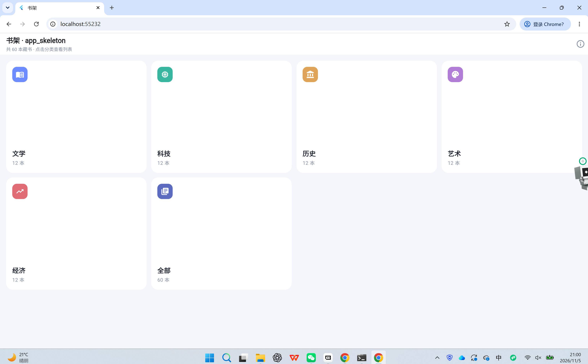
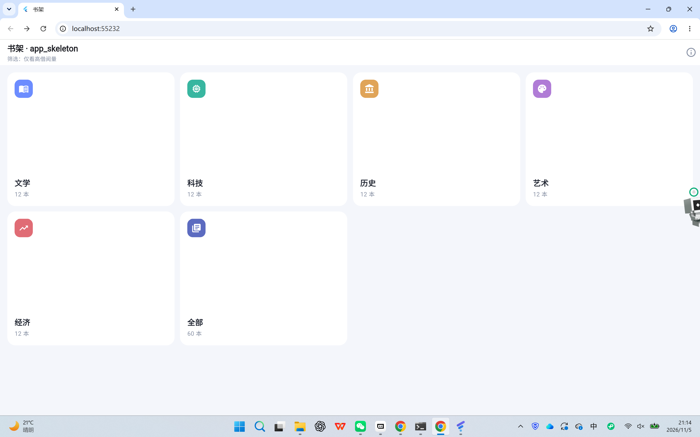
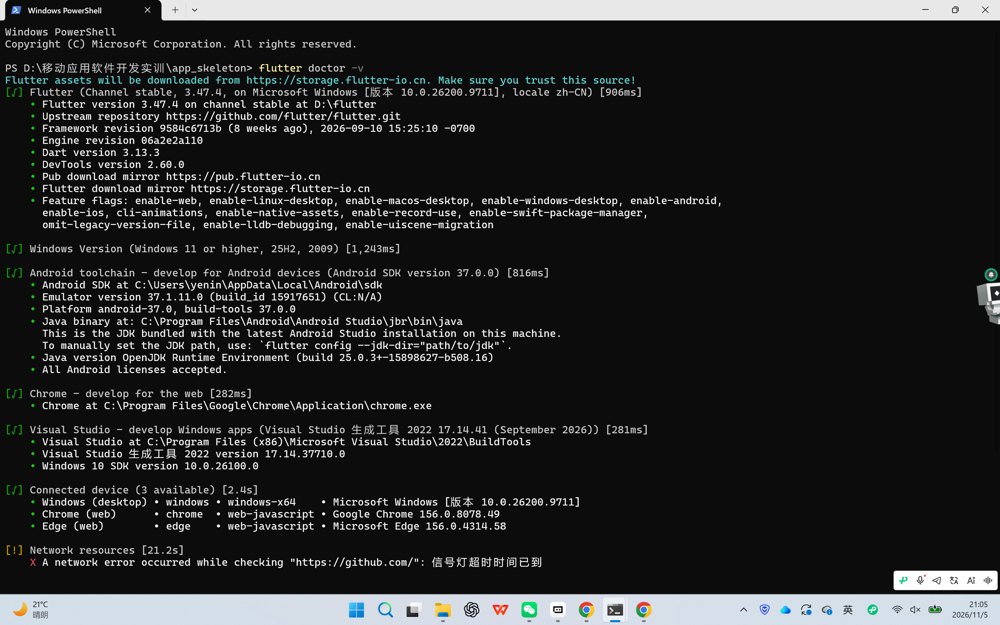
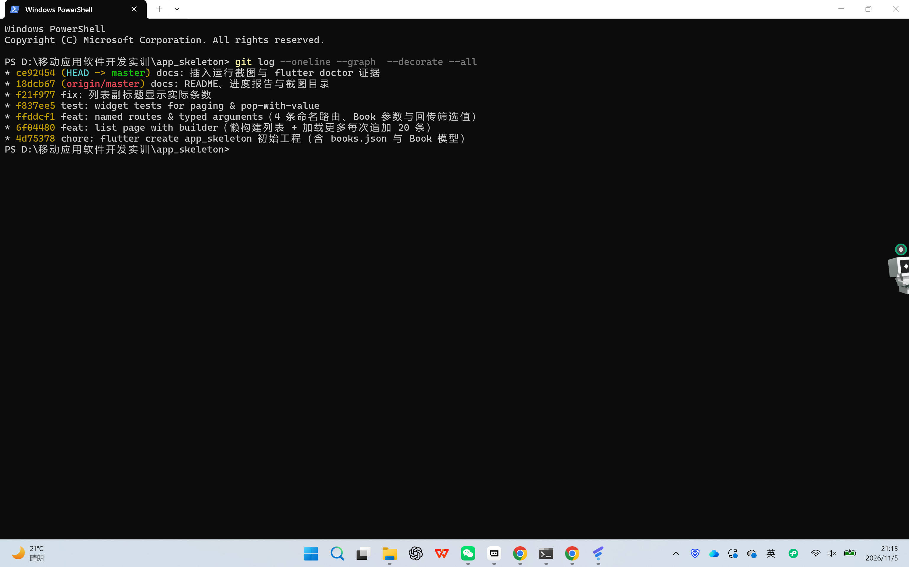

# 进度报告7（第9周·可滚动组件与多页面结构）

使用方式：在模板上作答，作答完成后将全文复制到雨课堂答题区（图片无法粘贴时在雨课堂编辑器中手工重新上传），并将同一内容存入自己仓库 lecture7/progress.md。

## 一、任务理解

本次作业围绕“可滚动组件与多页面结构”展开，要求在独立仓库 lecture7 中完成三件事并留下可核查的证据：

1. 案例复现：按实践指南第五节的三个步骤复现课堂案例 app_skeleton——“数据与列表页 → 路由与传参 → 网格首页与回传值”，每步一次 Git 提交，代码可运行；

2. 自主实践五项 + AI 标注：① 列表分页模拟（builder + “加载更多”每次追加 20 条）；② 命名路由表不少于 4 条且全部走命名式；③ 参数与返回值（去程传强类型 Book、回程至少一处生效）；④ 组件抽取至少 2 个参数化复用组件并放入 lib/widgets/；⑤ 标注 AI 使用方式并验证；

3. 提交物：本报告十节全文复制到雨课堂；同一内容存入仓库 lecture7/progress.md；代码推送到独立仓库 lecture7（3 次以上提交、含 README）。

验收标准：① 三页跳转闭环（首页→列表→详情→返回）；② 详情页参数正确、字段与列表项一致；③ 回传值在首页 AppBar 副标题生效；④ 列表用 ListView.builder 懒构建且“加载更多”每次追加 20 条；⑤ 4 条命名路由全部注册、运行期无“could not find a generator for route”；⑥ 至少 2 个参数化组件位于 lib/widgets/；⑦ 能口头解释命名路由与直接 Navigator.push 的取舍。

## 二、环境与工具

操作系统：Windows 11（64 位）；Flutter 3.47.4（stable）/ Dart 3.13.3 / DevTools 2.60.0；运行目标：Chrome（Web）为主，Windows 桌面备选（flutter run -d chrome / -d windows）；编辑器与终端：Trae CN + PowerShell。

AI 工具：TraeCode（DeepSeek-V4.1-Flash），用于页面骨架生成、分页与回传逻辑编写、测试问题排查。

版本控制：git 2.55.0，远端为 GitHub 独立仓库 lecture7（github.com/yeningjie/lecture7），仓库含 README。

数据说明：60 本模拟藏书由本地脚本生成并写入 assets/books.json（5 个分类，每类 12 本），不使用网络图片与第三方数据。

## 三、过程记录

2026-11-05，按时间线：

① flutter --version 确认环境（Flutter 3.47.4 / Dart 3.13.3）；

② flutter create --project-name app_skeleton --platforms=android,web,windows 生成工程；

③ 数据准备：编写 assets/books.json（60 本，5 类×12 本），复用第 4 课 Book 模型并补 fromJson，BookRepository 启动时预加载；

④ 提交 1：chore: flutter create app_skeleton 初始工程（含 books.json 与 Book 模型）；

⑤ 列表页：ListView.builder 懒构建，itemCount 随 _visible 变化，页脚“加载更多”每次追加 20 条；列表项抽成 BookTile；

⑥ 提交 2：feat: list page with builder（懒构建列表 + 加载更多每次追加 20 条）；

⑦ 路由与传参：main.dart 注册 4 条命名路由；详情页用 ModalRoute.of(context)!.settings.arguments 接收 Book 并完整显示字段；首页网格 CategoryCard 作为分类入口；

⑧ 回传值：详情页“借阅并回传”pop 带回字符串、列表页 await 接住并显示在 AppBar 副标题；列表页长按弹层选择“仅看高借阅量”后整体 pop 回首页，首页副标题显示筛选结果；关于页列出 4 条路由；

⑨ 提交 3：feat: named routes & typed arguments（4 条命名路由、Book 参数与回传筛选值）；

⑩ 验证：dart analyze lib test 输出 No issues found!；flutter test 3 个用例全部通过；flutter build web --release 构建成功；

⑪ 提交 4：test: widget tests for paging & pop-with-value；

⑫ 复查发现分类页不足 20 本时副标题仍显示“已显示 20 本”，改为显示实际条数，重新运行 analyze 与 test；提交 5：fix: 列表副标题显示实际条数；

⑬ 文档：编写 README（页面/路由/组件/提交记录）与本节进度报告，建立 docs/screenshots/；提交 6：docs: README、进度报告与截图目录；

⑭ 按截图清单逐页运行并截取证据，补齐第八节后提交 7 并推送 GitHub。

## 四、关键代码

代码段 1：命名路由表与去程传参（TraeCode 辅助生成，逐行核对）

```dart
// main.dart
routes: {
  '/': (_) => const HomePage(),
  '/list': (_) => const ListPage(),
  '/detail': (_) => const DetailPage(),
  '/about': (_) => const AboutPage(),
},

// home_page.dart：去程传分类名
final result = await Navigator.pushNamed(context, '/list', arguments: category);
```

逐行解释：

- routes 把 4 条路径与页面构造器绑定，页面地址集中在一处，新增页面只改这里；

- “_”是未使用的 BuildContext 参数占位；

- 去程用 arguments 传 String（分类名），目标页用 ModalRoute.of(context)!.settings.arguments 接收；

- pushNamed 返回 Future，await 后即可拿到回程值，未 pop 值时为 null。

验证：三条跳转逐页点击均进入对应页面，运行期无“could not find a generator for route”；关于页列出完整路由表。

代码段 2：ListView.builder 与“加载更多”（TraeCode 辅助生成，测试验证）

```dart
final itemCount = _visible < books.length ? _visible + 1 : books.length;
ListView.builder(
  itemCount: itemCount,
  itemBuilder: (context, index) {
    if (index >= _visible) {
      return Center(child: FilledButton.tonal(
        onPressed: () => setState(() => _visible += _pageSize),
        child: Text('加载更多（已显示 $_visible / ${books.length}）'),
      ));
    }
    final book = books[index];
    return BookTile(book: book, accent: accent, onTap: () => _openDetail(book));
  },
)
```

逐行解释：

- itemCount = 已显示条数 + 1 个页脚，只有还有剩余数据时才多出页脚；

- itemBuilder 只为滚入视口的项创建 Widget（懒构建），60 条数据首帧只创建可见的若干项；

- index >= _visible 时返回“加载更多”按钮，点击把 _visible 增加 20 并 setState 重建；

- _pageSize 用常量而非魔法数字，页大小改动只改一处。

验证：进入“全部（共 60 本）”，副标题显示“已显示 20 本”，点“加载更多（已显示 20 / 60）”后变为“已显示 40 本”；widget 用例断言 20→40。

代码段 3：回程传值两处（TraeCode 辅助生成，运行截图 + 用例验证）

```dart
// 详情页：带值返回
FilledButton(onPressed: () => Navigator.pop(context, '已借阅《${book.title}》'), ...)

// 列表页：发起端 await 接住
final result = await Navigator.pushNamed(context, '/detail', arguments: book);
if (result != null && mounted) {
  setState(() => _lastAction = result as String);
  ScaffoldMessenger.of(context)..showSnackBar(SnackBar(content: Text(result)));
}
```

逐行解释：

- pop 的第二个参数即回程值；“返回（不带值）”按钮调用无参 pop，回程为 null；

- 发起端必须 await，否则结果无人接收（即指南预警的 EX9 病根）；

- mounted 判断避免页面已销毁时 setState 抛异常；

- 结果同时写入 AppBar 副标题（_lastAction）与 SnackBar，截图证据更稳定。

验证：详情页点“借阅并回传”后，列表页副标题显示“上次操作：已借阅《活着》”；点“返回（不带值）”则副标题不变。

## 五、检查点结果

1. 三页跳转闭环——已完成。路径：首页点“全部”→ 列表页 → 点任一本书 → 详情页 → “返回（不带值）”回列表 → 返回首页；4 条路由全部命名式（首页 / 列表 / 详情 / 关于）。证据：home.png、list.png、detail.png、about.png。

2. 详情参数正确——已完成。以《活着》（id 1、余华、文学、1990 年、31 次）为例，详情页显示的编号、作者、分类、出版年份、借阅次数与简介与 assets/books.json 中该记录逐项一致，标题与列表项相同。证据：detail.png。

3. 回传值生效——已完成两处：① 详情页“借阅并回传”把“已借阅《活着》”带回列表页 AppBar 副标题（back_value.png）；② 列表页长按弹出“仅看高借阅量（借阅次数 ≥ 50）”，选择后列表页整体 pop 回首页，首页 AppBar 副标题变为“筛选：仅看高借阅量”（filter_back.png）。

4. 命名路由与懒构建——已完成：命名路由 4 条（≥4）；ListView.builder 每页 20 条、“加载更多”每次 +20（list.png、load_more.png）；运行期控制台无路由异常与溢出告警。

5. 组件抽取——已完成 2 个参数化组件：CategoryCard（名称/数量/图标/主题色/回调）、BookTile（Book/主题色/点击与长按回调），均位于 lib/widgets/。

## 六、问题与调试

问题 1（真实发生）：分页演示拿不到“加载更多”按钮。

- 现象：最初按每类 12 本准备数据，进入任一分类列表只有 12 条，滚到底也没有按钮。

- 定位：读 list_page.dart 的 itemCount 逻辑——只有 _visible < books.length 时才多出页脚；12 < 20 恒不成立，页脚永远不出现。不是渲染问题，而是数据规模与页大小不匹配。

- 解决：首页增加“全部（共 60 本）”入口专门用于分页演示，分类入口仍按分类过滤；AppBar 副标题改为显示 min(_visible, 总数)，避免分类页不足 20 条时仍写“已显示 20 本”。验证：全部列表 20→40→60，按钮文案随 _visible 变化。

问题 2（真实发生）：widget 测试点不到详情页按钮，用例失败。

- 现象：flutter test 输出 Warning: tap() ... Offset(593.0, 623.0) ... outside the bounds of the root ... Size(800.0, 600.0)，随后断言“上次操作：已借阅《活着》”找不到。

- 定位：测试默认视口 800×600，详情页两个按钮在 y≈623，超出视口；应用逻辑没问题，是测试没有先滚动。

- 解决：先 tester.ensureVisible(find.text('借阅并回传')) 并 pumpAndSettle，再 tap；3 个用例全部通过，并在浏览器中确认按钮正常可见。

问题 3（规避记录）：指南预警的 arguments 接收时机。列表页若在 initState 中读取 ModalRoute 参数会拿不到（此时路由尚未完成装配），本实现把读取放在 didChangeDependencies/build，详情页在 build 内读取，运行与测试均无空指针异常。

## 七、AI使用记录

| 用途 | 指令摘要 | 输出 | 本人验证方式 |
| --- | --- | --- | --- |
| 数据与模型 | “生成 60 本五分类图书 JSON，字段同第 4 课 Book，并写 BookRepository 启动预加载” | assets/books.json、book.dart、book_repository.dart | dart analyze 零告警；首页总数显示 60，分类各 12 本 |
| 页面骨架 | “搭 app_skeleton 三页：网格首页、builder 列表页（每页 20 + 加载更多）、详情页显示全部字段” | home/list/detail 三页 | 逐页运行截图；三页闭环手动走通 |
| 路由与回传 | “注册 4 条命名路由，详情用 arguments 传 Book，pop 回传借阅结果，列表长按筛选回传首页” | main.dart 路由表与各页 pushNamed/pop | 运行核对副标题变化；widget 用例断言回传值 |
| 测试修复 | “tap 报 outside the bounds，如何让详情页按钮可点” | ensureVisible 方案 | 改后 flutter test 3/3 通过 |

先猜后比（与 TraeCode 方案的对照差异）：

1. 首页布局：我先猜“用 ListView 竖排 6 个分类卡片”，TraeCode 用 GridView.builder + 响应式 crossAxisCount。差异原因：分类入口是并列关系，网格更省纵向空间，宽屏可 4 列；采纳网格。

2. 分页实现：我先猜“一次性构建 60 条、用 Offstage 隐藏多余的”，TraeCode 用 itemCount 随 _visible 变化。差异原因：前者失去懒构建意义（本课考点正是“只有滚入视口才创建”）；采纳 builder 方案。

3. 回传筛选值：我先猜“用全局变量记状态，首页读它”，TraeCode 用 pop 返回值 + await 接住。差异原因：全局变量绕开了路由的返回值语义，也无法处理“用户未选择”的情况；采纳回传值。

## 八、证据截图

（截图统一存放于仓库 docs/screenshots/，每图配一句话说明）



首页网格：5 个分类 + “全部”入口，AppBar 副标题“共 60 本藏书 · 点击分类查看列表”。


列表页初始状态：“全部（共 60 本）”“已显示 20 本”，列表项由 ListView.builder 懒构建。


点击“加载更多”后“已显示 40 本”，按钮文案变为 40 / 60。


详情页：命名路由携带 Book 进入，《活着》的编号/作者/分类/年份/借阅次数/简介完整显示。


详情页“借阅并回传”后回到列表页，AppBar 副标题显示“上次操作：已借阅《活着》”。



列表页长按选择“仅看高借阅量”后回到首页，AppBar 副标题显示“筛选：仅看高借阅量”。


关于页：4 条命名路由表与两个参数化组件清单。



flutter doctor 输出：Flutter 3.47.4 与 Chrome/Windows/Android 工具链状态。



git log --oneline --graph --decorate --all：各步骤提交与远程同步情况。

## 九、自评

- 案例复现 app_skeleton（可运行、三页闭环）——已完成；

- 按步骤提交（≥3 次）——已完成 6 次（初始工程、列表页、路由与回传、测试、副标题修正、文档），截图补齐后第 7 次；

- 列表分页模拟（builder + 加载更多 +20）——已完成，“全部”入口 20→40→60；

- 命名路由表 ≥4 条——已完成（/、/list、/detail、/about），全部命名式；

- 参数与返回值（强类型 Book、回程 ≥1 处）——已完成两处回传（详情→列表、列表→首页）；

- 组件抽取 ≥2 个参数化复用组件——已完成（CategoryCard、BookTile，位于 lib/widgets/）；

- AI 使用标注——已完成（第七节，含先猜后比）；

- README 与独立仓库 lecture7——已完成；

- 证据截图（运行 + flutter doctor + Git 记录）——已完成 9 张；

- 独立研究任务（选做）——未做：CustomScrollView/Sliver 重写、路由守卫、自定义转场计划课后补。

## 十、一句话收获与下一步计划

一句话收获：命名路由把“页面地址”集中成一张表，arguments 负责去程、pop 负责回程——三页之间的数据流因此可预期地一进一出，而不是靠全局变量猜状态。

遗留问题：Sliver 重写同屏滚动、路由守卫（本地标志位拦截未登录跳转）、PageRouteBuilder 自定义转场尚未动手；“加载更多”仍是按钮触发，未做滚动到底自动加载。

下次预习要点：表单与校验（TextField 控制器、焦点与错误提示）、数据持久化与网络请求；复习 ListView.builder 的 itemCount/itemBuilder 语义，为下一课的数据链路打底。
